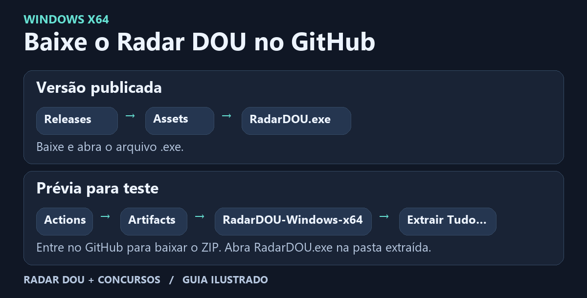

# Radar DOU + Concursos

Acompanhe um nome no Diário Oficial da União e concursos nacionais ou da sua UF. O Radar guarda o histórico no dispositivo e avisa pelo Telegram quando encontra novidades.

**[Baixar para Windows](https://github.com/BrandonSaraiva/Dou-e-Concursos/releases/latest)** · **[Baixar APK para Android](https://github.com/BrandonSaraiva/Dou-e-Concursos/releases/download/android-v1.2.1/RadarDOU.apk)** · [Guia Windows](docs/GUIA_WINDOWS.md) · [Guia Android](ANDROID.md) · [Capturas do Telegram](https://github.com/BrandonSaraiva/Dou-e-Concursos/blob/main/docs/DEMONSTRACAO.md)

## Comece pelo Windows

1. Em **Releases → Assets**, baixe **RadarDOU.exe**. O executável é para Windows x64 e já inclui Python.
2. Abra o aplicativo, preencha seu ID numérico do Telegram e o token do bot criado no BotFather.
3. Escolha os monitores, clique em **Salvar configurações**, teste a conexão e selecione **Ativar radar**.

O [guia Windows](docs/GUIA_WINDOWS.md) mostra como criar o bot, localizar seu ID, configurar o Radar e atualizar sem perder os dados.

## Comece pelo Android

Baixe **RadarDOU.apk** pelo link acima, abra o arquivo em **Downloads** e siga o [guia Android](ANDROID.md) para configurar o bot e testar os alertas.

## O que o Radar acompanha

| Monitor | Como funciona |
| --- | --- |
| **Diário Oficial da União** | Pesquisa um nome ou expressão e verifica as publicações em um intervalo configurável. |
| **Concursos públicos** | Consulta o catálogo nacional e, opcionalmente, o da UF escolhida a cada hora. A lista estadual omite oportunidades que também estão na lista nacional. |
| **Telegram** | Mostra notícias, publicações e links em um chat privado. Use `/status`, `/verificar` e `/concursos` para consultar ou atualizar os dados. |

A primeira consulta bem-sucedida de cada monitor ou região cria uma referência. Os avisos começam quando aparecem novidades. No Windows, o Radar pode continuar na bandeja após fechar a janela e iniciar ao entrar na sua conta.

As fontes são a [pesquisa pública do DOU](https://www.in.gov.br/consulta/-/buscar/dou) e o portal editorial [Concursos no Brasil](https://concursosnobrasil.com/concursos/). O Radar é um projeto pessoal independente. Confira prazos e requisitos no edital do órgão. A disponibilidade do monitoramento depende da conexão, do dispositivo ativo e das fontes.

## Veja as respostas no Telegram

A [demonstração com capturas reais](docs/DEMONSTRACAO.md) mostra o menu, o status, as publicações do DOU, as listas nacional e estadual e as consultas manuais.

Para relatar um problema, abra uma [Issue](https://github.com/BrandonSaraiva/Dou-e-Concursos/issues) e omita tokens, IDs e dados monitorados.

Projeto distribu?do sob a [licen?a MIT](LICENSE).
