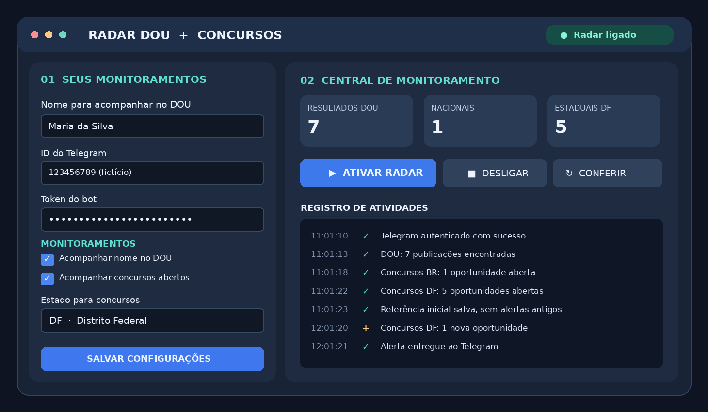
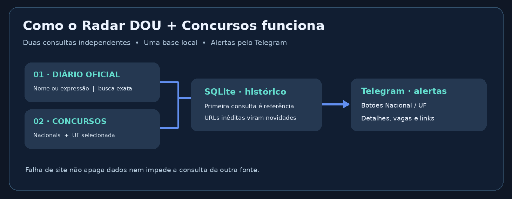
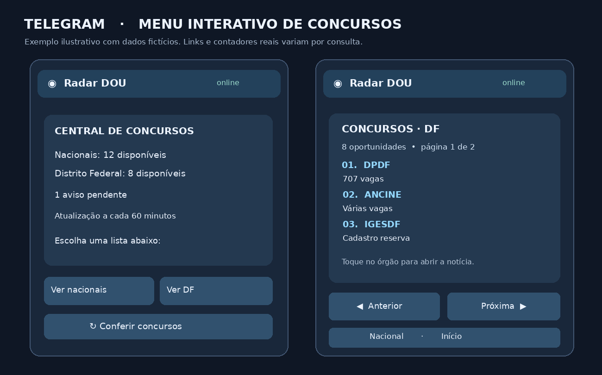
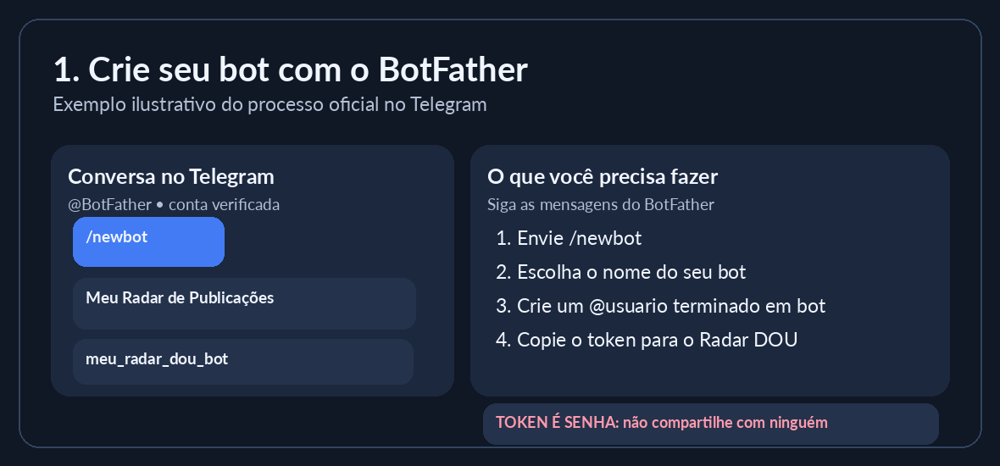
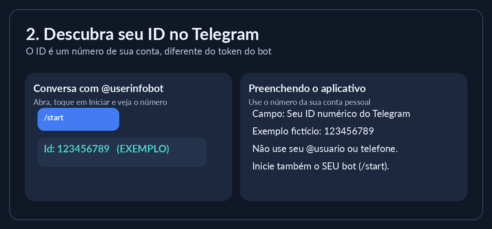
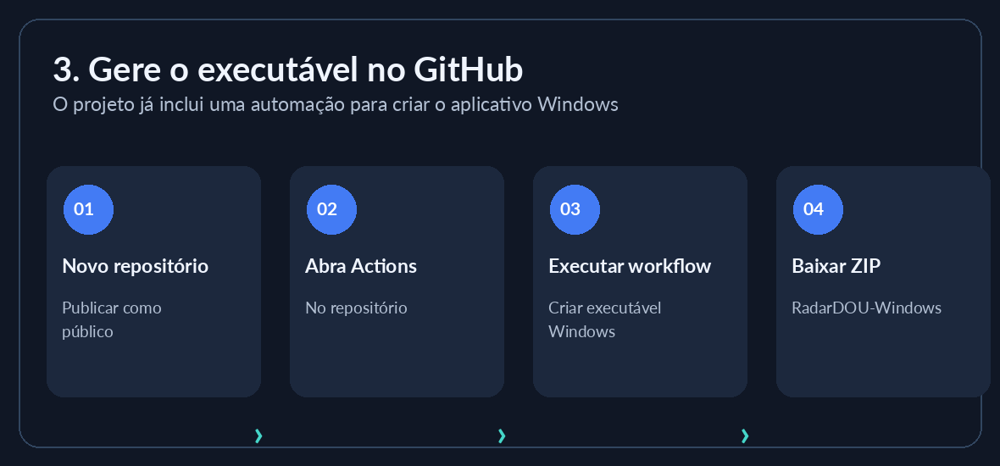
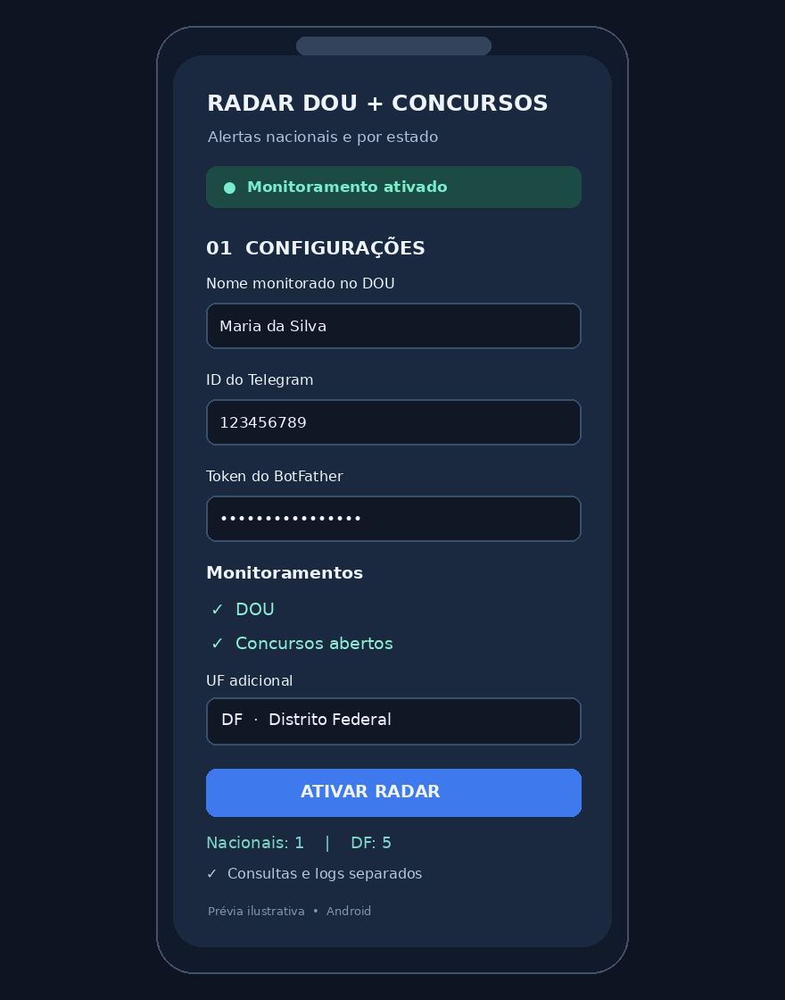
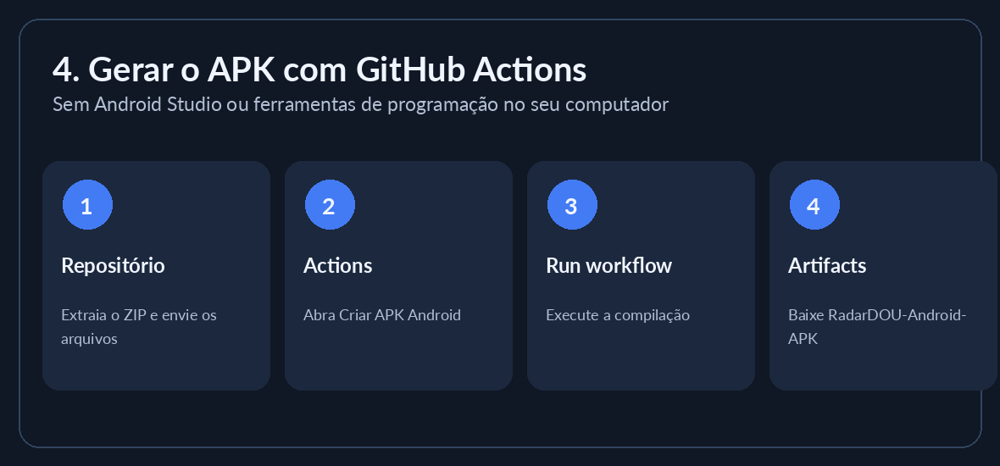

<div align="center">

# 📡 Radar DOU + Concursos
### Alertas do Diário Oficial e concursos públicos no seu Telegram.

**Monitore um nome no DOU, os concursos nacionais e os concursos abertos da UF escolhida. Receba avisos no Telegram quando surgir uma novidade.**

[](.github/workflows/test.yml)
[](.github/workflows/build-windows.yml)
[](.github/workflows/build-android.yml)
[](LICENSE)

**Quem baixa o `.exe` compilado não precisa saber programar, ter VS Code ou instalar Python.**



*Ilustração da interface Windows. Os exemplos de nomes, identificadores e tokens mostrados no projeto são fictícios.*

</div>

## ✨ O que a ferramenta faz?

O aplicativo consulta duas fontes independentes: a [pesquisa pública do Diário Oficial da União](https://www.in.gov.br/consulta/-/buscar/dou) e a listagem de concursos do [Concursos no Brasil](https://concursosnobrasil.com/concursos/). Compara os resultados com o banco SQLite local e avisa no Telegram quando aparecem **publicações ou oportunidades ainda não vistas**.

Você pode **ativar só o DOU, só os concursos ou os dois**. Quando os concursos estão ativos, a busca nacional é automática; você também pode escolher uma UF (ex.: `DF`, `GO`, `SP`) ou deixar **Somente nacional**.

- **Windows:** aplicativo gráfico com nome, ID do Telegram, token, botões e logs. Depois de gerado, basta executar `RadarDOU.exe`.
- **Android:** aplicativo gráfico com os mesmos campos e um **serviço em primeiro plano** que pode continuar ativo mesmo quando você fecha a tela e abre o Telegram.
- **Histórico persistente:** banco SQLite local, inclusive depois de reiniciar. Cada pesquisa cria sua própria referência inicial sem alertas antigos.
- **Monitoramento do DOU:** intervalo configurável de 15 a 1.440 minutos (padrão: 60).
- **Monitoramento de concursos:** busca nacional **e** na UF escolhida a cada **60 minutos**, usando as páginas completas `.../concursos/br/` e `.../concursos/df/` (para DF), não o resumo de cinco resultados da página inicial.
- **Abertos, não previstos:** ignora itens marcados como `previsto` na listagem estadual. A fonte também inclui processos seletivos e estágios.
- **Listagem no Telegram:** menu com botões 🌎 Nacionais e 📍 UF, páginas de cinco resultados, vagas e link para cada notícia.
- **Sem notificações duplicadas:** identifica cada oportunidade pela URL e impede que um edital nacional repetido na listagem estadual gere dois alertas.
- **Consultas manuais:** pelo aplicativo ou pelo comando `/verificar` no Telegram.
- **Erros observáveis:** logs informam autenticação, conexão, quantidade de resultados, dificuldades do DOU e envio de mensagens.
- **Privacidade:** cada instalação usa credenciais próprias; arquivos pessoais não são colocados no repositório. O bot aceita comandos somente do ID Telegram configurado.





*Menu ilustrativo. As oportunidades exibidas dependem de cada consulta e a situação de inscrições deve ser confirmada no edital.*

> **Importante:** esta é uma ferramenta independente, não oficial. Depende da disponibilidade e do formato da busca do DOU e da conexão com a internet. Não há garantia de disponibilidade contínua ou prazo exato de alerta. O trecho da pesquisa não substitui o texto oficial. O bot está limitado a um ID e um nome por instalação.

## 🧭 Comece aqui: tutorial para quem nunca criou um bot

Você fará **três coisas**: criar um bot no Telegram, descobrir seu ID numérico e preencher os campos do Radar DOU. Isso vale para Windows e Android.

### Passo 1. Crie seu bot gratuitamente no Telegram



1. Abra o [Telegram](https://telegram.org/) no celular ou no computador.
2. Toque neste link: **[@BotFather](https://t.me/BotFather)**. Verifique que é o bot oficial, com selo de verificação do Telegram.
3. Aperte **Iniciar** e mande a mensagem `/newbot`.
4. Ele pedirá um nome amigável. Exemplo: `Meu Radar DOU`.
5. Depois pedirá um nome de usuário único **terminado em `bot`**, como `meu_radar_pessoal_bot`. Se o nome já estiver em uso, escolha outro.
6. O BotFather responderá com um **token**, uma sequência de números, `:` e letras. Exemplo **fictício**: `123456789:EXEMPLO_NAO_USAR_ABCDEFGHJKLMN`.
7. Copie o token e **guarde como senha**. Cole-o somente no campo **Token do seu bot** do aplicativo.
8. Abra a conversa com o bot que acabou de criar e clique em **Iniciar** (ou mande `/start`). Isso é necessário para que ele possa enviar mensagens para você.

**Não confunda:** o **token** do bot não é o seu **ID do Telegram**. O campo de token precisa de toda a sequência, incluindo os dois-pontos. Se o token vazar, use `/revoke` no BotFather e atualize a configuração.

### Passo 2. Descubra o ID da sua conta



1. Abra **[@userinfobot](https://t.me/userinfobot)** no Telegram.
2. Toque em **Iniciar**.
3. Ele informará um número chamado `Id` ou `Your ID`, por exemplo `123456789` (**fictício**).
4. Copie **somente o número**, sem `@`, espaços ou telefone. No aplicativo, cole no campo **Seu ID numérico do Telegram**.
5. Verifique se você também iniciou a conversa com o bot que criou no passo 1.

### Passo 3. Abra e configure o Radar DOU

1. Abra a versão Windows ou Android conforme as instruções abaixo.
2. Marque **Monitorar nome no DOU** se desejar a pesquisa no Diário Oficial. Nesse caso, em **Nome ou expressão**, escreva um nome completo como `Maria da Silva`.
3. Marque **Monitorar concursos abertos** se desejar acompanhar oportunidades. A busca **Nacional** será incluída automaticamente.
4. Em **UF para concursos**, selecione `DF` (ou outra UF) para adicionar o monitoramento estadual. Se quiser somente concursos nacionais, deixe **Somente nacional**.
5. Em **ID do Telegram**, cole seu número do passo 2.
6. Em **Token**, cole o segredo recebido do BotFather.
7. Defina o intervalo do DOU (padrão 60 minutos). **Concursos sempre são conferidos a cada 60 minutos**.
8. Clique em **Salvar configurações** e **Testar conexão**. Uma mensagem deve chegar ao seu Telegram; se não chegar, confirme ID, token, rede e `/start` no seu bot.
9. Clique em **Ativar radar**. Na primeira pesquisa de cada fonte/região, os resultados existentes são a referência inicial, sem avisos antigos. Depois, novas URLs geram notificações.
10. No Telegram, envie `/concursos` e toque em **🌎 Nacional** ou **📍 DF**. Use **Próxima ▶** para navegar e abra cada notícia pelo link. A seleção de UF é feita no **aplicativo**, não pelo chat.

### O que faz cada botão?

| Campo ou botão | Função |
|---|---|
| **Nome ou expressão** | Texto a acompanhar na pesquisa do DOU. |
| **Seu ID do Telegram** | Conta autorizada a falar com o bot e receber alertas. |
| **Token do BotFather** | Credencial secreta que conecta o aplicativo ao seu bot. |
| **Monitorar nome no DOU** | Liga ou desliga a pesquisa de nomes no Diário Oficial. |
| **Monitorar concursos abertos** | Liga ou desliga o acompanhamento nacional/estadual. |
| **UF** | `Somente nacional` ou uma das 27 UFs; exemplo `DF`. A sigla fica salva. |
| **Intervalo** | Frequência de busca **do DOU**; concursos são conferidos de hora em hora. |
| **Salvar configurações** | Mantém os dados localmente após fechar e abrir de novo. |
| **Testar conexão** | Valida o token e tenta entregar uma mensagem ao seu chat. |
| **Ativar radar** | Liga o monitoramento e faz uma verificação inicial. |
| **Desligar** | Solicita parada segura, sem apagar o histórico. |
| **Conferir agora** | Verifica DOU e concursos ativados, além das consultas agendadas. |
| **Concursos nacionais** | Abre a lista nacional diretamente no portal. |
| **Total de concursos** | Mostra quantos nacionais e estaduais estavam listados na última consulta íntegra. |
| **Abrir pesquisa no DOU** | Abre a consulta pública correspondente ao nome preenchido. |
| **Registro de atividades** | Mostra autenticação, contagem, erros e alertas enviados. |

## 🖥️ Windows: como baixar e usar o executável

O código do repositório inclui uma rotina de compilação do arquivo `RadarDOU.exe` pelo **GitHub Actions**. Os usuários finais **não precisam instalar Python** para executar o EXE já compilado. O **ZIP do código-fonte não inclui um `.exe` previamente compilado**: a automação gera um Windows `.exe` real, testa sua inicialização e, se estiver tudo certo, **adiciona automaticamente o executável em `downloads/RadarDOU.exe` no próprio repositório**. A automação também oferece o binário em `Actions > Artifacts`.

> A compilação ocorre em Windows 10/11 x64 compatível, sem precisar instalar Python no computador de quem usar o executável. Se você tiver modificado o código, **espere a compilação automática terminar** antes de distribuir o novo arquivo.



1. No GitHub, abra seu repositório depois de publicar os arquivos deste projeto.
2. Entre na aba **Actions**.
3. À esquerda, selecione **Criar executável Windows**.
4. Clique em **Run workflow** e confirme. Se o GitHub pedir autorização para executar workflows, permita para este repositório.
5. Quando o workflow terminar com êxito, abra sua execução e localize **Artifacts**.
6. Baixe o artefato **RadarDOU-Windows-[commit]**, extraia-o e execute `RadarDOU.exe`. Alternativamente, **espere o commit automático do Actions e baixe `downloads/RadarDOU.exe` diretamente pelo repositório**.
7. No primeiro uso, o Windows pode apresentar um aviso por ser um executável sem assinatura digital. Só execute se você confia no código que está compilando; leia os arquivos do projeto antes de aceitar.
8. Preencha os campos, teste a conexão e clique em **Ativar radar**.

**Para continuar monitorando:** deixe o aplicativo aberto e o computador ligado, com internet. Fechar a janela desliga o serviço Windows. Na próxima abertura, as configurações e o banco continuam presentes.

**Alternativa para desenvolvedores:** com Python 3.11+ instalado, use `rodar_com_python.bat` ou `GERAR_EXE_WINDOWS.bat` para executar/compilar localmente. Esses atalhos não são necessários para quem baixa o `.exe` pronto.

## 📱 Android: como gerar, instalar e usar o APK



*Imagem ilustrativa, não captura de tela de APK instalado.*

### Gerar o APK sem Android Studio



1. No GitHub, abra o repositório com todos os arquivos do Radar DOU.
2. Vá à aba **Actions**.
3. Escolha **Criar APK Android**.
4. Clique em **Run workflow** e confirme.
5. Após uma compilação **concluída com sucesso**, abra a execução e, em **Artifacts**, baixe **RadarDOU-Android-APK**.
6. Extraia o ZIP de artefato baixado: dentro dele deverá estar o arquivo `.apk`.
7. Envie o APK para o seu celular e abra-o. Se necessário, o Android solicitará autorização para **instalar aplicativos desta fonte**. Autorize apenas se você confia na compilação feita no seu repositório.
8. Abra o **Radar DOU**, conceda a permissão de notificações solicitada, preencha os dados e teste o bot.
9. Toque em **ATIVAR RADAR**. O aplicativo inicia um **serviço em primeiro plano** com uma notificação contínua; depois disso você pode sair da tela do Radar DOU e utilizar apenas o Telegram.
10. Para ver os registros, consultar imediatamente ou desativar, reabra o Radar DOU.

### Ajuste a bateria para reduzir interrupções

As palavras dos menus variam de fabricante para fabricante, mas normalmente o caminho é **Configurações → Aplicativos → Radar DOU → Bateria → Sem restrições** ou **Permitir execução em segundo plano**. Permita notificações para identificar o serviço ativo. Evite usar a função **Forçar parada** se quiser continuar monitorando.

**Limitações reais do Android:** o serviço depende de o celular permanecer ligado e conectado à internet. Android e fabricantes podem interromper processos para economizar bateria, especialmente sob restrições agressivas. O serviço `foreground` com reinício solicitado ao sistema reduz interrupções, mas **não garante funcionamento 24 horas por dia**. O APK **não reinicia automaticamente ao ligar o telefone**; reabra e ative o radar se reiniciar o aparelho. Desinstalar o aplicativo remove seu banco e suas configurações. Também não há integração com o navegador Playwright no APK: a consulta móvel usa requisições HTTP. Se o site do DOU bloquear esse tipo de acesso, os logs mostrarão o erro e o histórico será preservado.

> **Estado da compilação:** o repositório contém o **código e o workflow de compilação Android**. O projeto precisa passar pelo Buildozer/Android SDK e por teste em dispositivo físico; um APK compilado e funcional **não foi validado** nesta entrega. Se o workflow falhar, os logs do GitHub Actions mostrarão o erro de compilação. Serviços Android e regras de distribuição pela Google Play exigem revisão adicional antes de publicar numa loja.

## 📦 Publicar este ZIP em outra conta GitHub

**Atenção: não envie o ZIP inteiro como se fosse um arquivo do projeto.** O conteúdo deve ser descompactado primeiro.

1. Entre na outra conta em [github.com](https://github.com/) e clique em **+ → New repository**.
2. Escolha um nome, por exemplo `radar-dou`, e marque **Public**. Na criação, deixe desmarcada a opção de criar README, pois o ZIP já tem um `README.md` completo.
3. Crie o repositório.
4. Extraia o ZIP do Radar DOU em uma pasta no seu computador.
5. Na página inicial do repositório vazio, escolha **uploading an existing file** (ou **Add file → Upload files**).
6. Arraste **o conteúdo extraído** para o GitHub, incluindo a pasta `.github` com os workflows, a pasta `radar_dou`, a pasta `assets`, o `buildozer.spec` e o `README.md`.
7. Clique em **Commit changes**. O README aparecerá automaticamente na página principal.
8. A automação **Criar executável Windows** é acionada no primeiro envio do código à branch `main`/`master`. Aguarde o resultado na aba **Actions**. Se o workflow passar, o GitHub adiciona `downloads/RadarDOU.exe`, `downloads/SOURCE_COMMIT.txt` e o SHA-256 ao próprio repositório automaticamente. Se o arquivo ainda não apareceu, confira se Actions está habilitado e se o job concluiu sem erros.
9. O APK é gerado separadamente no workflow **Criar APK Android**. Não é entregue pré-compilado e precisa de teste real em aparelho.

**Nunca publique seu token pessoal.** Este ZIP inclui apenas código e ilustrações fictícias. O token só deve ser digitado no aplicativo instalado.

## 🤖 Comandos disponíveis no Telegram

| Mensagem ao seu bot | O que acontece |
|---|---|
| `/start` | Mostra a apresentação e os botões principais. |
| `/verificar` | Consulta imediatamente os monitores ativados (DOU e concursos). |
| `/concursos` | Mostra o menu com contadores e botões Nacional e UF. |
| `/nacionais` | Lista os concursos abertos nacionais em páginas de cinco, com vagas e links. |
| `/estaduais` | Lista os concursos abertos na UF selecionada no app. |
| `/conferirconcursos` | Atualiza somente o catálogo de concursos, sem aguardar uma hora. |
| `/status` | Exibe resultados e últimos sucessos/erros do DOU e dos concursos. |
| `/ultimas` ou `/resultados` | Lista as últimas dez publicações registradas no DOU. |
| `/ajuda` | Explica os comandos e alertas. |

**O programa precisa estar ativo em um dispositivo para que o bot responda.** O Telegram não hospeda o seu programa; ele somente transporta os comandos e as notificações.

## 🔍 Como o código funciona

### Monitoramento do DOU

1. `radar_dou/scraper.py` consulta `https://www.in.gov.br/consulta/-/buscar/dou` com `q`, `s=todos`, `exactDate=all` e `sortType=0`.
2. A busca lê prioritariamente o JSON incorporado no HTML, inclusive `jsonArray`, dados de publicação, data, seção, órgão, tipo de ato e trecho. Também existe um parser HTML alternativo.
3. O scraper confere a contagem total e pagina os resultados disponíveis (até 30 páginas). **Se houver bloqueio ou página incompleta, a consulta falha sem sobrescrever a referência.**
4. `radar_dou/database.py` registra o monitor, as publicações e uma fila de alertas em SQLite. Cada publicação é identificada pelo hash da **URL do documento**, não apenas por seu título.
5. `radar_dou/service.py` autentica com o Telegram, agenda as consultas e entrega notificações à conta autorizada. As filas mantêm avisos não entregues.

### Monitoramento de concursos nacionais e estaduais

1. `radar_dou/concursos.py` visita `https://concursosnobrasil.com/concursos/br/` para os **nacionais**, e, caso configurado, `https://concursosnobrasil.com/concursos/UF/` para o **estado** (a UF aparece em minúsculas na URL).
2. Localiza a seção **Concursos Públicos Abertos** e extrai seus links mesmo quando o site usa tabelas, cards ou listas (sem depender da classe CSS `post-title`), obtendo o nome do órgão, o título da notícia, a quantidade textual de vagas (`707`, `27.279`, `Várias` etc.) e o link. Exclui linhas marcadas como **previsto**. O site pode mudar o HTML; se a página não corresponder ao esperado, o coletor falha e preserva a última lista íntegra.
3. O banco SQLite salva a URL normalizada, os dados exibidos, o momento da primeira identificação, a condição de listagem atual e a fila de alertas. **Na primeira consulta não avisa sobre os itens já publicados.**
4. A cada **60 minutos** ele verifica quais URLs são inéditas. Itens que saíram e voltaram à lista não provocam alerta duplicado. Concursos nacionais que também aparecem na UF selecionada são listados somente em **Nacionais**.
5. O Telegram envia alertas com título, órgão, vagas, categoria (Nacional/UF) e botão para a notícia; os comandos `/concursos`, `/nacionais` e `/estaduais` exibem listas com paginação de cinco em cinco.
6. Cada monitor tem seu próprio último sucesso e último erro, para que uma falha no DOU não interrompa os concursos (e vice-versa). A fila tenta entregar novamente mensagens que a API do Telegram não aceitou.

### Interface e configurações

- `radar_dou/gui.py` contém o painel Windows. `radar_dou/android_ui.py` contém o painel Android. No Android, `android_service.py` roda em processo separado e `radar_dou/android_runtime.py` transporta comandos/heartbeat por arquivos privados.
- `radar_dou/settings.py` persiste nome, Telegram, token, UF e caixas de seleção. No Windows, usa DPAPI; no Android, salva o token em pasta privada do app (**sem criptografia extra por este código**).
- Ao mudar de UF, o histórico anterior permanece no banco. A nova UF recebe sua própria referência inicial, sem alertas antigos.

### Onde ficam as informações?

| Ambiente | Configurações, histórico e logs |
|---|---|
| Windows | Pasta `RadarDOU` dentro de `%APPDATA%` da conta do Windows. |
| Android | Diretório interno privado do aplicativo, acessível aos seus próprios processos. |

Arquivos importantes: `config.json`, `radar.sqlite3`, `radar.log` e, em caso de erro ao abrir o EXE, `falha_inicializacao.txt`. **Não compartilhe `config.json`**, pois ele contém ou permite recuperar sua credencial Telegram. Fazer backup do banco SQLite preserva o histórico, mas não equivale a exportar sua senha.

### Segurança, dados e alertas

- O projeto não usa API paga e não envia suas configurações para um servidor próprio.
- O token é enviado somente para a API oficial do Telegram para autenticar e emitir mensagens.
- O ID informado restringe os comandos de administração a um chat privado autorizado.
- Os arquivos privados são excluídos do Git por `.gitignore`.
- O sistema realiza notificações com política de entrega **ao menos uma vez**; se uma interrupção ocorrer entre enviar e confirmar no SQLite, uma duplicação rara é possível.
- Alterar o nome monitorado do DOU cria nova referência daquela pesquisa. Alterar a UF não apaga o histórico das outras regiões já consultadas.
- O site de concursos é um **portal jornalístico privado**. A posição na página de “abertos” não confirma que a inscrição ainda aceita candidaturas, nem garante dados completos. Confira o edital e o site do órgão organizador.
- Não é um serviço oficial, nem afiliado ao DOU, ao Telegram ou ao Concursos no Brasil. Use os acessos com moderação e respeite os termos de uso e o `robots.txt` de cada fonte. Mudanças de layout ou bloqueio podem exigir manutenção.

## 🔧 Corrigindo o erro “Tabela de concursos abertos ausente” (novembro de 2026)

As categorias `.../concursos/br/` e `.../concursos/df/` podem apresentar links em elementos que não são `<table>` com `a.post-title`, que era uma hipótese rígida do coletor anterior. A atualização usa o título **Concursos Públicos Abertos** como delimitador, lê links elegíveis em tabelas/listas/cards e para antes da seção **Previstos**. Quando não consegue validar o HTML, mantém o último catálogo íntegro no SQLite e registra erro visível nos logs. No Windows, uma falha HTTP/HTML aciona uma tentativa alternativa com navegador em modo oculto, se houver Edge, Chrome ou Chromium disponível; no Android, essa tentativa não existe.

**Para atualizar apenas o coletor, sem apagar sua configuração:**

1. Feche o Radar pelo botão **Desligar** e feche a janela.
2. Extraia o pacote de correção na pasta do projeto, substituindo somente `radar_dou/concursos.py` (a pasta `radar_dou` já existe ao lado de `main.py`).
3. Execute novamente `rodar_com_python.bat` ou compile um novo `RadarDOU.exe` com `GERAR_EXE_WINDOWS.bat` / Actions. **O EXE já compilado não muda quando você edita o `.py`**.
4. Ative o Radar e envie `/conferirconcursos` ao bot. Nos logs, procure `HTTP 200` e `Concursos DF: ... abertos reconhecidos` ou a explicação da falha.

Se ainda falhar, encaminhe somente as linhas `CONCURSOS BR` e `CONCURSOS UF` dos logs, removendo qualquer informação privada antes de compartilhar. Para validar a continuidade de monitoramento, mantenha a máquina ligada e o aplicativo ativo. Esta correção tem testes automatizados locais, mas **não foi confirmada por teste HTTP direto contra o site** neste ambiente de entrega.

## 🛟 Perguntas frequentes

**Salvei, mas o Telegram não recebeu a mensagem de teste.** Confirme que usou seu ID numérico, e não o número do bot. Reabra o bot que você criou e toque em **Iniciar**. Confirme o token recebido pelo BotFather, incluindo `:`. Se o bot estiver sendo executado em outro aparelho ao mesmo tempo, poderá haver conflito no recebimento de comandos.

**A primeira consulta trouxe muitos resultados, mas não fui avisado.** É esperado. Eles constituem a referência inicial para não inundar seu Telegram com avisos antigos.

**O portal está indisponível ou com layout alterado.** Os logs mostram o HTTP retornado (ex.: 200, 403, 503), a URL, o tamanho do HTML recebido e quantos links de concursos foram identificados. Erro HTTP significa indisponibilidade/bloqueio; erro de seção significa incompatibilidade do HTML. A versão corrigida não exige mais a presença de uma `<table>` nem da classe `post-title`. No Windows, caso a consulta HTTP não valide a página, o aplicativo tenta novamente usando Edge/Chrome em modo oculto. No Android, permanece somente a conexão HTTP. O sistema **não interpreta erro como zero resultados**; preserva o último histórico.

**Escolhi DF e só vejo concursos nacionais.** Confira se marcou **Monitorar concursos abertos**, escolheu `DF`, salvou e reativou o serviço. Use `/conferirconcursos` para consultar agora. Concursos nacionais repetidos na listagem do DF são mostrados apenas na lista Nacional.

**Os resultados são realmente concursos com inscrição aberta?** São oportunidades classificadas como *abertas* pelo Concursos no Brasil na última consulta. O site pode mostrar processos seletivos ou estágios, e os prazos podem ter mudado. Verifique sempre a notícia, o edital e o site oficial do órgão.

**Posso mudar de estado depois?** Sim. Salve a outra UF e reative o serviço; a nova região inicia um histórico próprio, preservando o histórico do estado anterior.

**Preciso ficar com o Telegram aberto?** Não. É necessário apenas que o programa esteja ativo no Windows ou serviço esteja ativo no Android, com internet. Você pode abrir o Telegram quando quiser.

**Posso usar o mesmo bot no PC e no Android simultaneamente?** Não recomendamos. A API de `getUpdates` do Telegram pode produzir conflito entre consumidores do mesmo token. Prefira um dispositivo ativo por bot ou crie bots independentes.

**Posso monitorar mais de um nome?** Cada instalação foi projetada para um nome por vez. Para vários nomes simultâneos, seria necessário ampliar o cadastro e o agendamento com múltiplas pesquisas.

**E se o aplicativo fechar?** No Windows, o bot é encerrado. No Android, o serviço separado pode continuar (sujeito à política de bateria do sistema). Depois de uma reinicialização do telefone, ative novamente pelo aplicativo.

## 🧑‍💻 Testes e desenvolvimento

```bash
python -m pip install -r requirements.txt -r requirements-dev.txt
python -m pytest -q
```

Build local para Windows, com dependências instaladas (ou dê dois cliques em `GERAR_EXE_WINDOWS.bat`):

```powershell
python -m PyInstaller --noconfirm --clean --onefile --windowed --name RadarDOU --collect-all telegram --collect-all apscheduler --collect-all playwright --collect-all certifi main.py
```

Build Android (Linux/WSL com SDK/NDK por conta do Buildozer):

```bash
python -m pip install buildozer
buildozer android debug
```

O executável contém o interpretador Python e dependências empacotados; por isso **o usuário final não instala Python**. A criação do EXE precisa ocorrer no Windows (localmente ou pelo workflow GitHub). Esta entrega foi validada com testes locais de código, **mas o EXE real não pôde ser compilado neste ambiente Linux**. Ele será gerado no runner Windows do GitHub após a publicação do repositório.

Para usuários comuns, recomendamos baixar o EXE da pasta `downloads/` após o build bem-sucedido. O projeto publica o código sob licença [MIT](LICENSE).

### Referências técnicas

- [Busca pública oficial do DOU](https://www.in.gov.br/consulta/-/buscar/dou)
- [Portal Concursos no Brasil — Abertos](https://concursosnobrasil.com/concursos/)
- [Concursos nacionais](https://concursosnobrasil.com/concursos/br/)
- [Concursos do Distrito Federal](https://concursosnobrasil.com/concursos/df/)
- [BotFather: bots do Telegram](https://t.me/BotFather)
- [Documentação da Bot API do Telegram](https://core.telegram.org/bots/api)
- [Serviços do python-for-android](https://python-for-android.readthedocs.io/en/latest/services/)
- [Buildozer oficial](https://github.com/kivy/buildozer)
- [Documentação do Android sobre serviços em primeiro plano](https://developer.android.com/develop/background-work/services/fgs/declare)

### O programa abre uma tela preta e fecha sozinho?

Use **`INICIAR_SEM_FECHAR.bat`** na pasta onde está `main.py` (extraia todo o ZIP antes).
Esse inicializador abre o PowerShell com `-NoExit`, verifica Python/Tkinter e as bibliotecas, tenta abrir a interface e registra o resultado em `diagnostico_inicio.txt`. Assim, mesmo que a janela gráfica falhe, será possível identificar a causa.

**Importante:** `diagnostico_inicio.txt` é privado e está no `.gitignore`. Antes de enviar o arquivo a terceiros, confirme se não contém o token do seu bot ou informações pessoais do computador. A versão compilada não depende de Python instalado; este diagnóstico se aplica à execução pelo código-fonte.
