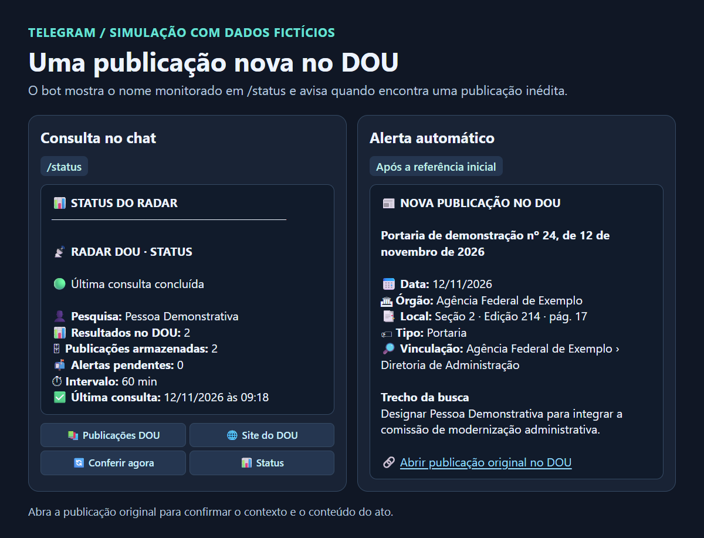
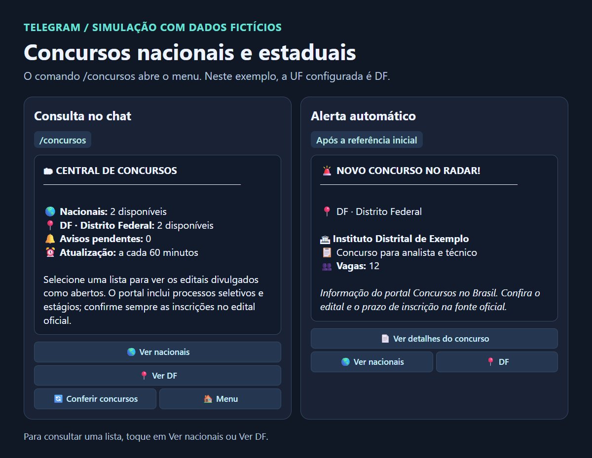
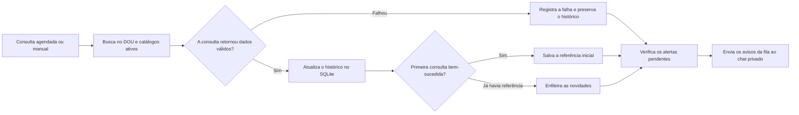

# Demonstração do Radar

[Voltar ao projeto](../README.md) · [Instalar e configurar](GUIA_WINDOWS.md) · [Desenvolvimento](DESENVOLVIMENTO.md)

O Radar consulta as fontes enquanto estiver ativo. Você pode fechar a janela do Windows, deixar o ícone na bandeja e acompanhar as novidades no chat privado do seu bot.

As imagens abaixo são prévias ilustradas com dados fictícios. O gerador executa os comandos e os ciclos de alertas do próprio Radar com catálogos de exemplo, SQLite temporário e um Telegram simulado. O texto e os botões vêm das respostas geradas pelo aplicativo. [Código da demonstração](../assets/create_telegram_previews.py)

## Pesquisa de um nome no DOU

No aplicativo, marque **Monitorar nome no DOU**, preencha **Nome ou expressão para acompanhar** e escolha a frequência. O Radar valida e pagina as respostas da busca pública do DOU antes de atualizar o histórico.

No chat, use **`/status`** para conferir a expressão pesquisada e a última consulta. **`/ultimas`** lista as publicações já registradas. Quando uma publicação nova corresponde à expressão, o aviso inclui o título, a seção, um trecho e um link para o original.

## Concursos nacionais e estaduais

Marque **Monitorar concursos abertos**. Com uma UF selecionada, o Radar consulta o catálogo nacional e o catálogo estadual a cada 60 minutos. Use **`/concursos`** para ver os contadores e abrir as listas. **`/nacionais`** e **`/estaduais`** abrem cada lista diretamente. Os resultados são paginados de cinco em cinco.

As listas mostram oportunidades classificadas como abertas pelo portal Concursos no Brasil. Confirme as inscrições, os prazos e as vagas no edital oficial. Um concurso nacional que também consta no catálogo estadual aparece na lista nacional.

## O que acontece quando o Radar roda

| Momento | O que o Radar faz | O que você vê |
| --- | --- | --- |
| **Ativar radar** | Autentica no Telegram, agenda as consultas e inicia a primeira verificação. | A conexão e o andamento aparecem no **Registro de atividades**. |
| **Primeira consulta bem-sucedida** | Guarda os resultados de cada monitor ou região como referência no SQLite. | Os resultados ficam disponíveis no chat. O Radar ainda está formando a referência para alertas futuros. |
| **Consultas seguintes** | Compara as URLs com o histórico e põe novidades na fila. | As novidades encontradas geram avisos no chat, com link para a publicação ou notícia. |
| **Consulta manual** | Roda os monitores ativos após **Conferir agora** no app ou **`/verificar`** no Telegram. | Veja o resumo da consulta no chat ao usar o comando. |
| **Uma fonte falha** | Preserva o último histórico bem-sucedido. | O **Registro de atividades** e **`/status`** indicam a falha. |
| **Um aviso fica pendente** | Persiste a fila e tenta a entrega de novo em outro ciclo. | **`/status`** mostra pendências. Uma confirmação perdida pode provocar um reenvio. |

## Repita o fluxo no seu computador

1. Siga o [guia Windows](GUIA_WINDOWS.md) para configurar o seu próprio bot.
2. Clique em **Testar conexão com Telegram**. O bot deve enviar a mensagem abaixo, mesmo antes de iniciar o monitoramento.

   > ✅ Radar conectado! O Telegram receberá alertas de DOU e/ou concursos conforme suas escolhas.

3. Clique em **Ativar radar** e envie `/start` no chat para abrir o menu do Radar. Depois da primeira consulta, envie `/status`, `/ultimas` e `/concursos` para conferir o histórico disponível.
4. Deixe o Radar na bandeja para acompanhar as próximas verificações. Você também pode usar `/verificar` para consultar a fonte no momento. Uma nova consulta só gera um alerta novo quando encontra uma novidade em relação à referência. As consultas ficam pausadas enquanto o PC estiver desligado ou suspenso.

Use dados fictícios se for compartilhar imagens. Mantenha o token do bot, o ID da sua conta, o arquivo de configuração e o histórico local em privado.

## Confira o cenário sem conectar um bot

Os [testes da integração](../tests/test_service_concursos.py) simulam o Telegram. Eles verificam que a primeira lista não gera alertas retroativos, que uma oportunidade nova gera aviso e que a mesma oportunidade não é enviada de novo no ciclo seguinte. O [guia de desenvolvimento](DESENVOLVIMENTO.md#execute-o-projeto-no-windows) mostra como executar a suíte.
