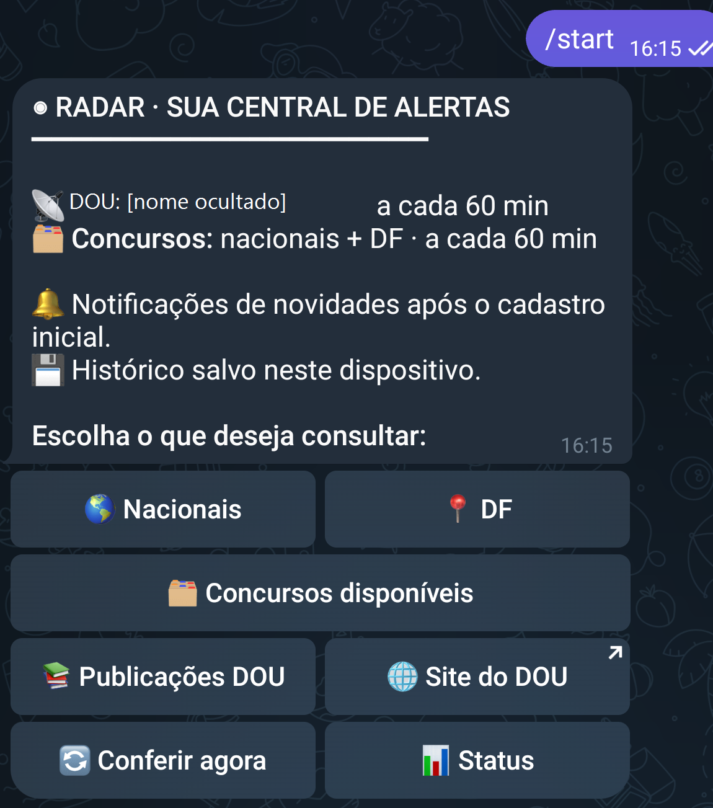
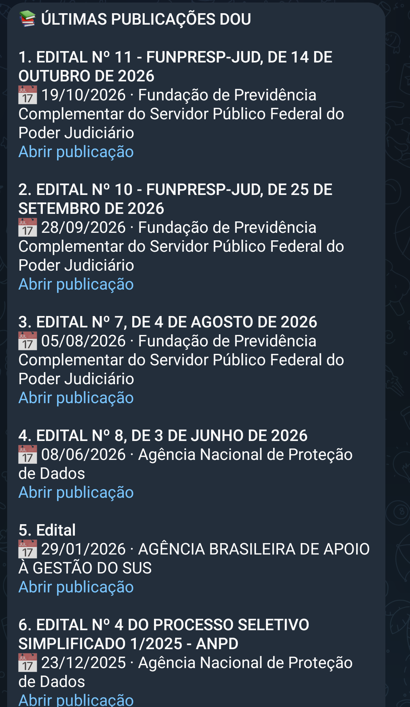
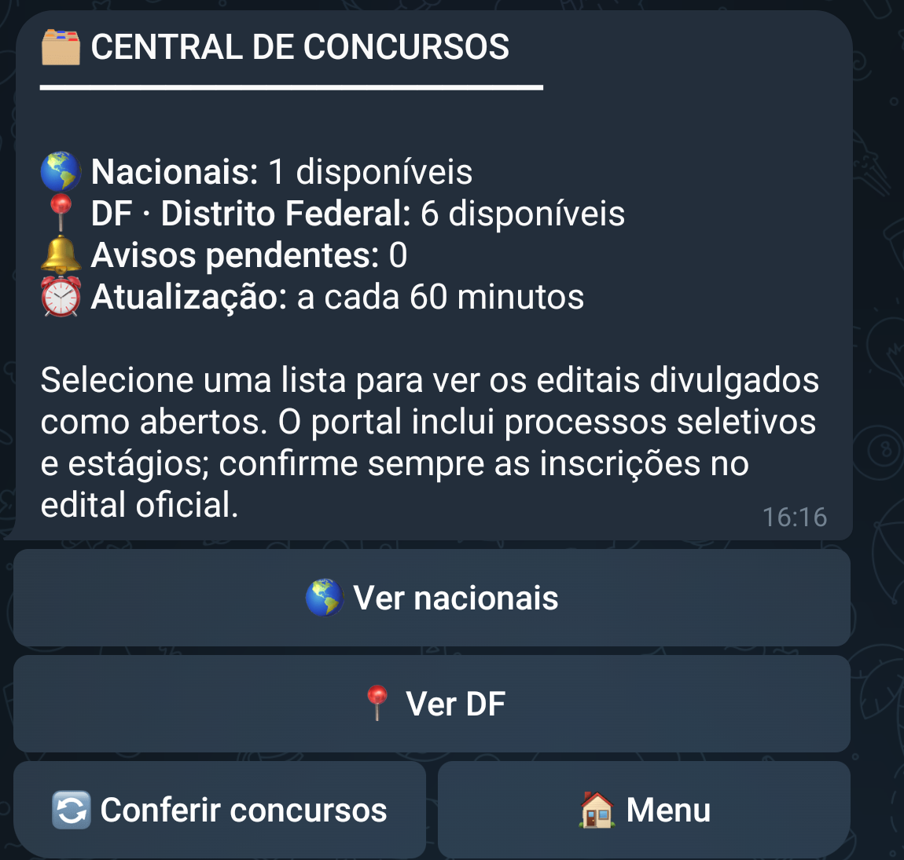
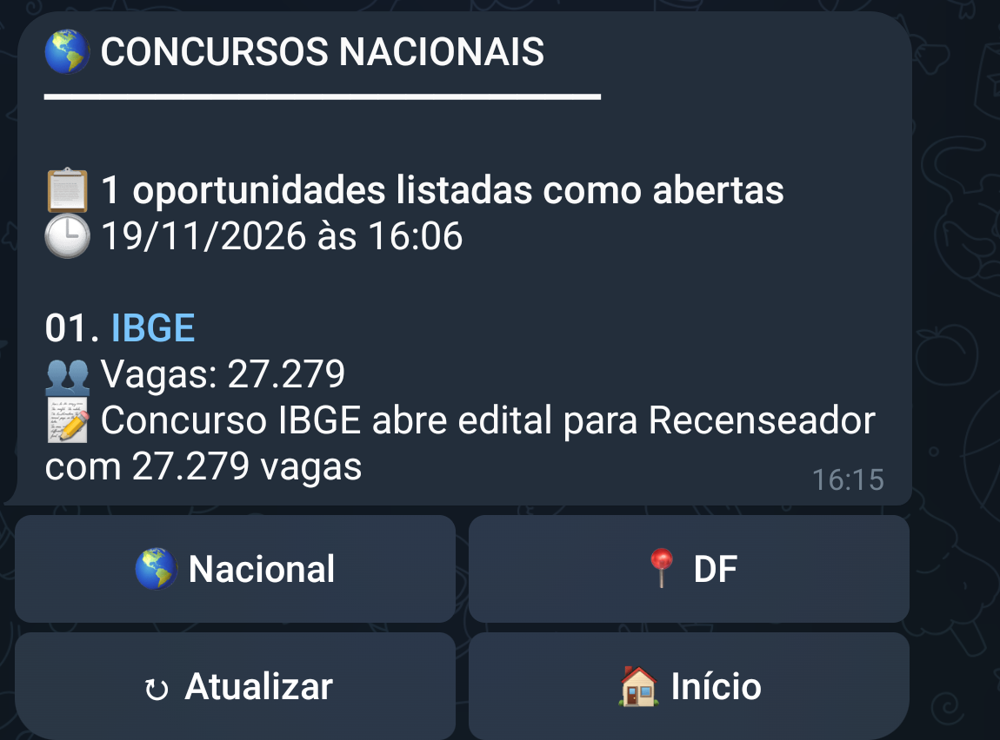
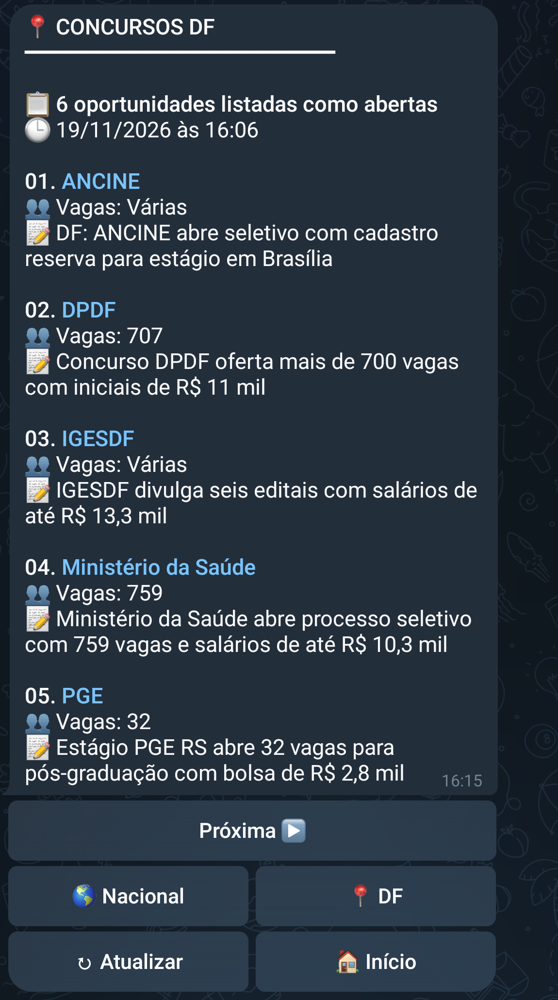
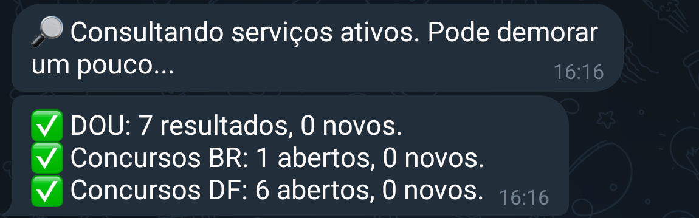
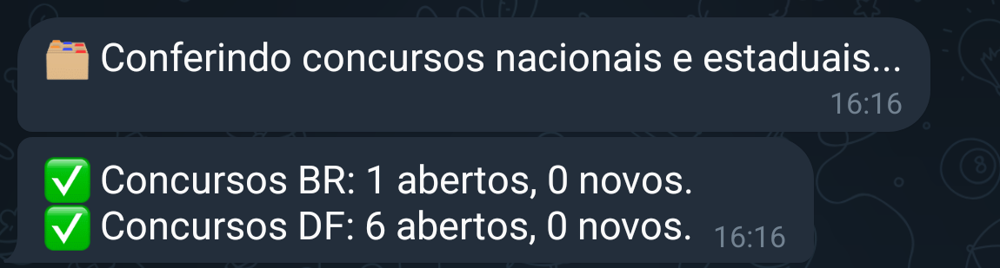
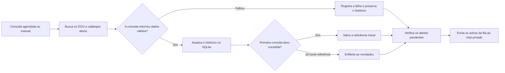

# Demonstração do Radar

[Voltar ao projeto](../README.md) · [Instalar e configurar](GUIA_WINDOWS.md) · [Desenvolvimento](DESENVOLVIMENTO.md)

O Radar consulta as fontes enquanto estiver ativo. Você pode fechar a janela do Windows, deixar o ícone na bandeja e acompanhar as novidades no chat privado do seu bot.

Os recortes do Telegram foram feitos durante uma execução real em **19 de novembro de 2026**. O nome monitorado foi ocultado. As listas, datas e contagens registram aquela consulta. Para conferir vagas, prazos e inscrições atuais, consulte o edital oficial.

## Menu do Radar

Envie **`/start`** no chat com o seu bot. O menu mostra os monitores ativos e o intervalo de consulta. Pelos botões, você pode abrir as listas de concursos, ver as publicações do DOU, consultar o status ou pedir uma nova verificação.

## Pesquisa de um nome no DOU

No aplicativo, marque **Monitorar nome no DOU**, preencha **Nome ou expressão para acompanhar** e escolha a frequência. O Radar valida e pagina as respostas da busca pública do DOU antes de atualizar o histórico.

### Status do monitoramento

Use **`/status`** ou toque em **Status**. A resposta mostra quantas publicações foram encontradas e armazenadas, os alertas pendentes, a hora da última consulta e o resumo dos concursos monitorados.

### Publicações registradas

Envie **`/ultimas`** ou toque em **Publicações DOU** para listar o que já foi encontrado. Toque em **Abrir publicação** abaixo de um resultado para ler o original no Diário Oficial.

## Concursos nacionais e estaduais

Marque **Monitorar concursos abertos**. Com uma UF selecionada, o Radar consulta o catálogo nacional e o catálogo estadual a cada 60 minutos.

### Central de concursos

Envie **`/concursos`** ou toque em **Concursos disponíveis** para ver os contadores. Na central, **Ver nacionais** abre a lista nacional e **Ver DF**, neste exemplo, abre a lista da UF configurada.

### Listas nacional e estadual

Os comandos **`/nacionais`** e **`/estaduais`** abrem as listas diretamente. Cada resultado mostra o órgão, o número de vagas informado pela fonte e o título da matéria. As listas têm até cinco resultados por página. Quando há mais, toque em **Próxima**.

  
  

As listas mostram oportunidades classificadas como abertas pelo portal Concursos no Brasil. Um concurso nacional que também consta no catálogo estadual aparece na lista nacional.

## Consulte agora pelo Telegram

Envie **`/verificar`** ou toque em **Conferir agora** para atualizar todos os monitores ativos. Na consulta registrada abaixo, o Radar encontrou sete publicações do DOU, uma oportunidade nacional e seis no DF. Todos esses itens já estavam no histórico, por isso as três linhas indicam zero novidades.

Para atualizar só os concursos, envie **`/conferirconcursos`** ou toque em **Conferir concursos** na central. O resumo mostra o resultado nacional e o da UF configurada.

## Alertas automáticos simulados

Estas duas prévias usam dados fictícios. O gerador usa o próprio código do Radar para mostrar o alerta de uma publicação inédita no DOU e o de um concurso novo. [Código da demonstração](../assets/create_telegram_previews.py)

## O que acontece quando o Radar roda

| Momento | O que o Radar faz | O que você vê |
| --- | --- | --- |
| **Ativar radar** | Autentica no Telegram, agenda as consultas e inicia a primeira verificação. | A conexão e o andamento aparecem no **Registro de atividades**. |
| **Primeira consulta bem-sucedida** | Guarda os resultados de cada monitor ou região como referência no SQLite. | Os resultados ficam disponíveis no chat. O Radar ainda está formando a referência para alertas futuros. |
| **Consultas seguintes** | Compara as URLs com o histórico e põe novidades na fila. | As novidades encontradas geram avisos no chat, com link para a publicação ou notícia. |
| **Consulta manual** | Roda os monitores ativos após **Conferir agora** no app ou **`/verificar`** no Telegram. | Veja o resumo da consulta no chat ao usar o comando. |
| **Uma fonte falha** | Preserva o último histórico bem-sucedido. | O **Registro de atividades** e **`/status`** indicam a falha. |
| **Um aviso fica pendente** | Persiste a fila e tenta a entrega de novo em outro ciclo. | **`/status`** mostra pendências. Uma confirmação perdida pode provocar um reenvio. |

## Repita o fluxo no seu computador

1. Siga o [guia Windows](GUIA_WINDOWS.md) para configurar o seu próprio bot.
2. Clique em **Testar conexão com Telegram**. O bot deve enviar a mensagem abaixo, mesmo antes de iniciar o monitoramento.

   > ✅ Radar conectado! O Telegram receberá alertas de DOU e/ou concursos conforme suas escolhas.

3. Clique em **Ativar radar** e envie `/start` no chat para abrir o menu do Radar. Depois da primeira consulta, envie `/status`, `/ultimas` e `/concursos` para conferir o histórico disponível.
4. Deixe o Radar na bandeja para acompanhar as próximas verificações. Você também pode usar `/verificar` para consultar a fonte no momento. Uma nova consulta só gera um alerta novo quando encontra uma novidade em relação à referência. As consultas ficam pausadas enquanto o PC estiver desligado ou suspenso.

Ao compartilhar um print, oculte dados pessoais. Mantenha o token do bot, o ID da sua conta, o arquivo de configuração e o histórico local em privado.

## Confira o cenário sem conectar um bot

Os [testes da integração](../tests/test_service_concursos.py) simulam o Telegram. Eles verificam que a primeira lista não gera alertas retroativos, que uma oportunidade nova gera aviso e que a mesma oportunidade não é enviada de novo no ciclo seguinte. O [guia de desenvolvimento](DESENVOLVIMENTO.md#execute-o-projeto-no-windows) mostra como executar a suíte.
