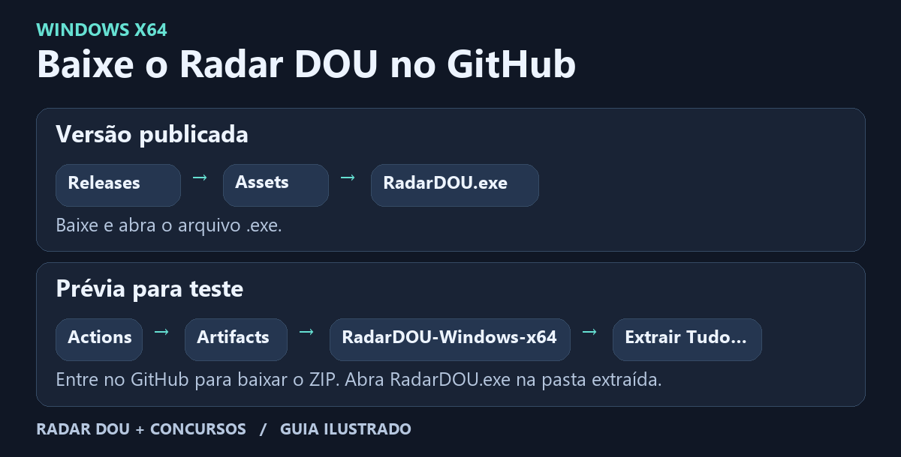
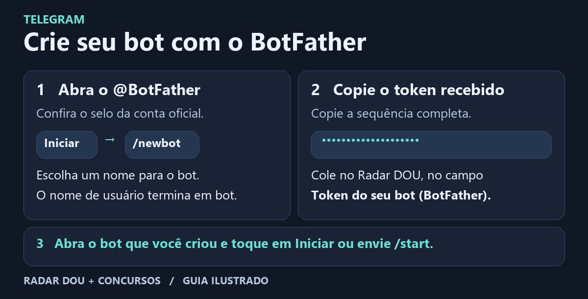
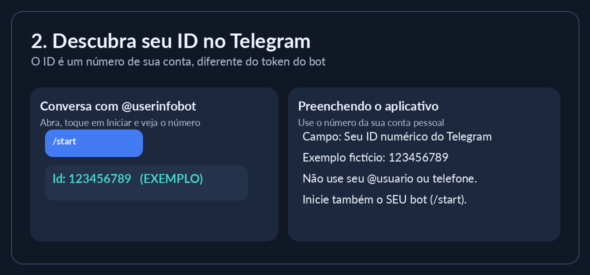
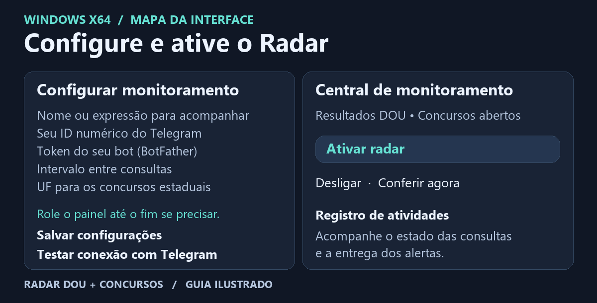
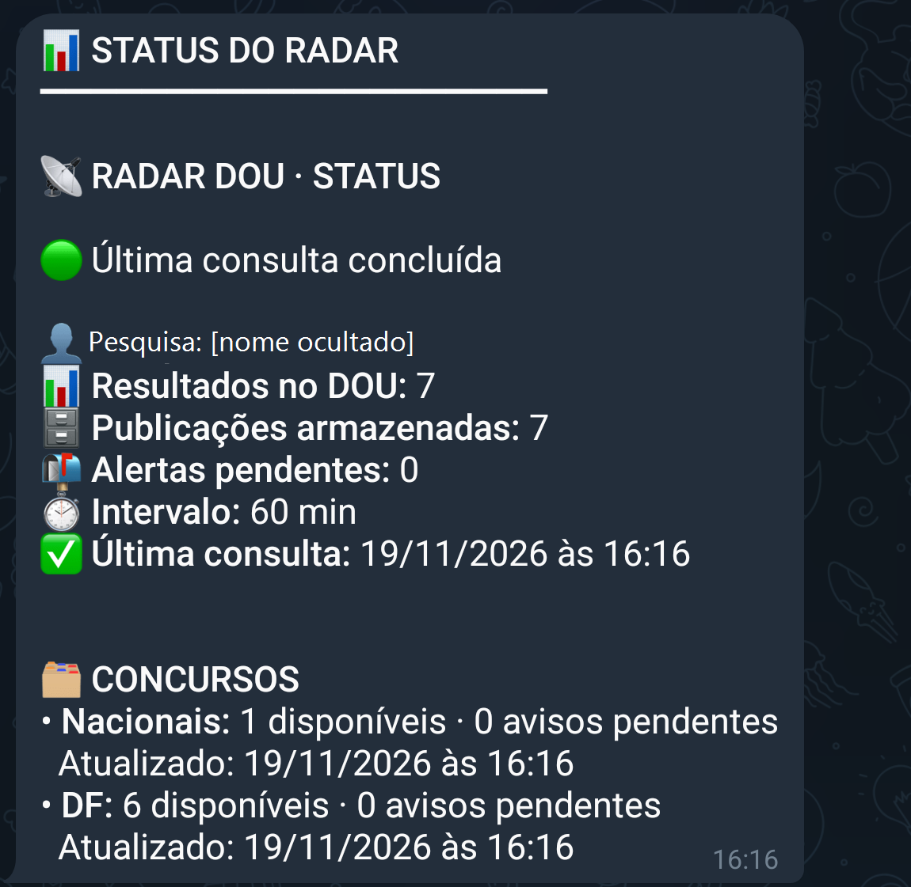
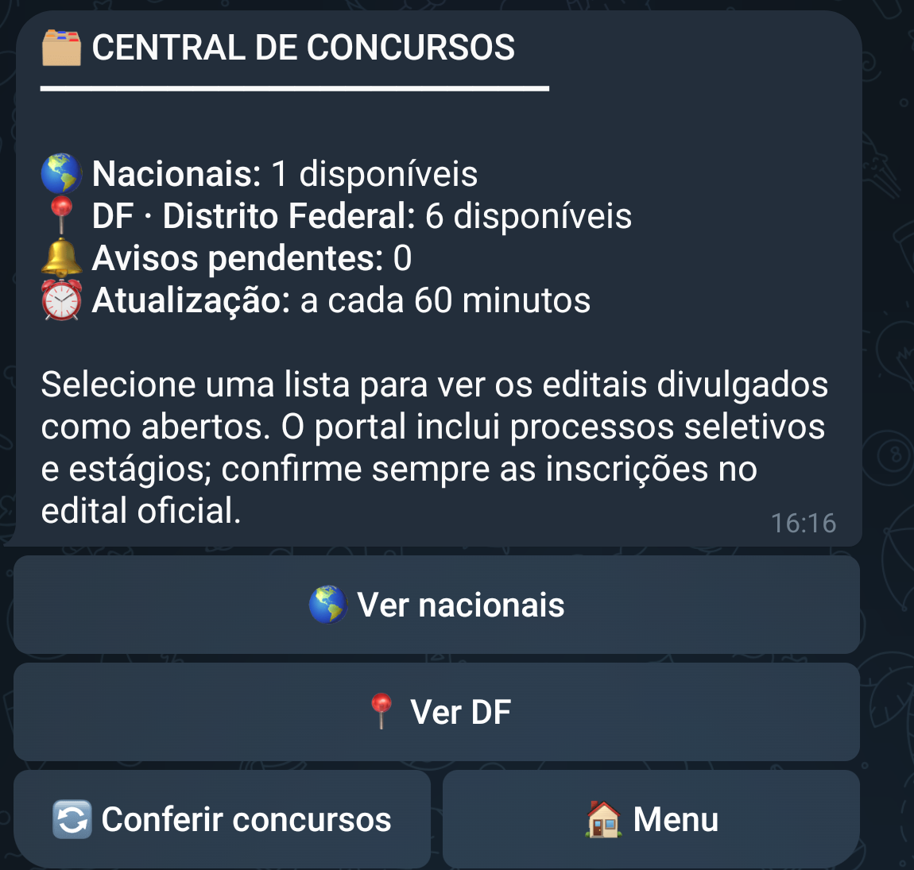

# Guia do Radar DOU no Windows

[Voltar ao projeto](../README.md) · [Guia Android](../ANDROID.md)

## 1. Baixe e abra o Radar

Você precisa de Windows x64, conexão com a internet e uma conta do Telegram. O executável já inclui Python e as dependências do Radar.

### Versão publicada

1. Abra o [repositório no GitHub](https://github.com/BrandonSaraiva/Dou-e-Concursos) e clique em **Releases** na lateral direita.
2. Na [versão mais recente](https://github.com/BrandonSaraiva/Dou-e-Concursos/releases/latest), localize **Assets** e clique em **RadarDOU.exe**. Os itens **Source code (zip)** e **Source code (tar.gz)** contêm o código-fonte.
3. Na pasta **Downloads**, dê dois cliques em **RadarDOU.exe**. Se quiser iniciar automaticamente com o Windows, guarde primeiro o arquivo em uma pasta fixa onde você pretende mantê-lo.

### Versão de teste pelo Actions

Use este caminho para testar uma compilação específica antes de ela ser publicada em Releases.

1. Entre na sua conta do GitHub, abra o [repositório](https://github.com/BrandonSaraiva/Dou-e-Concursos) e clique em **Actions**.
2. Na lateral esquerda, escolha **Compilar RadarDOU para Windows**. Clique na execução concluída com sucesso correspondente à branch ou ao Pull Request que quer testar.
3. Na página da execução, desça até **Artifacts** e clique em **RadarDOU-Windows-x64**. O workflow mantém esse ZIP por 30 dias.
4. Em **Downloads**, clique com o botão direito no ZIP, escolha **Extrair Tudo…** e abra **RadarDOU.exe** na pasta extraída.

Os dois downloads incluem `SHA256SUMS.txt` e `SOURCE_COMMIT.txt`, disponíveis separadamente em Releases e dentro do ZIP do Actions. Para verificar a integridade, compare a saída de `Get-FileHash .\RadarDOU.exe -Algorithm SHA256` no PowerShell com o hash publicado.

## 2. Crie seu bot no Telegram

1. No Telegram, abra o [@BotFather oficial](https://t.me/BotFather) e toque em **Iniciar**.
2. Envie `/newbot`. Escolha um nome visível, como **Meu Radar DOU**, e depois um nome de usuário disponível que termine em `bot`.
3. Copie o token completo que o BotFather devolver, incluindo os dois-pontos. Guarde-o como senha.
4. Abra o link para **o bot que você acabou de criar** e toque em **Iniciar**, ou envie `/start` nesse chat. É ali que você receberá os alertas.

Cole o token apenas no Radar. Se ele for exposto, revogue-o no BotFather, gere outro com `/token` e atualize a configuração. [Documentação do Telegram](https://core.telegram.org/bots/features#generating-an-authentication-token)

## 3. Descubra seu ID numérico

1. No Telegram, abra [@userinfobot](https://t.me/userinfobot), um bot de terceiros indicado pelo app para consultar o identificador da sua conta.
2. Toque em **Iniciar** e copie apenas o número mostrado no campo **Id**. Use o ID da sua conta pessoal, que receberá os alertas.

## 4. Configure o Radar e teste o Telegram

1. Em **Seu ID numérico do Telegram**, cole o número do passo anterior. Em **Token do seu bot (BotFather)**, cole o token completo.
2. Marque pelo menos um monitor. Para pesquisar no DOU, marque **Monitorar nome no DOU** e preencha **Nome ou expressão para acompanhar**. Em **Intervalo entre consultas**, escolha a frequência do DOU.
3. Para acompanhar concursos, marque **Monitorar concursos abertos**. Em **UF para os concursos estaduais**, escolha uma sigla, como **DF**, ou deixe **Somente nacional**. A consulta nacional está incluída e concursos são conferidos a cada hora.
4. Se os botões estiverem fora da área visível, use a barra de rolagem do painel esquerdo. Clique em **Salvar configurações** e em **Testar conexão com Telegram**. Confirme se a mensagem de teste chegou no chat do seu bot.
5. No painel direito, clique em **Ativar radar**. Consulte o **Registro de atividades** para acompanhar a conexão e a primeira consulta. A primeira consulta bem-sucedida de cada monitor ou região cria a referência inicial. Os alertas começam quando surgem novidades.

## 5. Use no dia a dia

- **Consultar agora.** Na janela, clique em **Conferir agora** com o Radar ativo. No chat do seu bot, `/verificar` aciona os monitores habilitados e `/conferirconcursos` verifica somente concursos.
- **Ver resultados.** Use `/status`, `/ultimas` ou `/concursos` no Telegram. Dentro de `/concursos`, escolha a lista nacional ou a da sua UF. Os links de concursos apontam para a matéria do portal. Confira o prazo e os requisitos no edital do órgão.
- **Fechar a janela.** Clique no **X** para deixar o Radar na bandeja, perto do relógio. Se o ícone estiver oculto, clique na seta da bandeja. Use o menu do ícone para **Abrir Radar DOU** ou **Sair do Radar DOU**.
- **Pausar.** Clique em **Desligar** para interromper o monitoramento com a janela aberta. Para encerrar o aplicativo, use **Sair do Radar DOU** na bandeja.
- **Alterar os monitores.** Clique em **Desligar**, aguarde a parada, altere os campos, salve e ative o Radar de novo. Trocar o termo do DOU reinicia o histórico dessa busca. Trocar a UF mantém os registros das UFs consultadas.
- **Iniciar ao entrar no Windows.** Marque **Iniciar monitoramento ao entrar no Windows** e clique em **Salvar configurações**. O monitoramento depende da sessão do Windows, da conexão e do computador ligado.

### Comandos no Telegram

Veja exemplos reais de status e concursos abaixo. A [galeria completa](https://github.com/BrandonSaraiva/Dou-e-Concursos/blob/main/docs/DEMONSTRACAO.md) também mostra o menu, o DOU e as consultas manuais.

Capturas reais do Telegram

| Comando | O que faz |
| --- | --- |
| `/start` ou `/ajuda` | Abre o menu principal ou a ajuda. |
| `/status` | Mostra o estado das consultas e dos alertas. |
| `/verificar` | Solicita uma consulta de todos os monitores ativos. |
| `/ultimas` ou `/resultados` | Lista publicações do DOU registradas pelo Radar. |
| `/concursos` | Abre o menu de concursos. |
| `/nacionais` ou `/estaduais` | Lista os concursos nacionais ou os da UF configurada. |
| `/conferirconcursos` | Solicita uma atualização do catálogo de concursos. |

## 6. Atualize preservando seus dados

1. Escolha **Sair do Radar DOU** na bandeja e confirme.
2. Baixe o novo executável em [Releases](https://github.com/BrandonSaraiva/Dou-e-Concursos/releases/latest) e substitua o arquivo anterior.
3. Abra a nova versão na mesma conta do Windows. O Radar mantém as configurações e o histórico em `%APPDATA%\RadarDOU`. Se mudou o caminho do executável e usa inicialização automática, clique em **Salvar configurações** para atualizar o caminho registrado.

## Solução de problemas

| Situação | O que conferir |
| --- | --- |
| O link de Releases ainda não mostra uma versão | Use o caminho de teste pelo **Actions** enquanto a publicação estiver pendente. |
| O GitHub mostra o artefato, mas o download não começa | Entre na sua conta do GitHub. Confirme que a compilação passou e o artefato ainda está no prazo de retenção. |
| O Windows bloqueou a abertura | Confira se o arquivo veio do repositório oficial e compare o SHA-256. Em um PC gerenciado, peça ao administrador para revisar o bloqueio registrado. |
| O app fechou antes de mostrar a janela | Abra `%APPDATA%\RadarDOU` no Explorador de Arquivos e procure `falha_inicializacao.txt`. |
| O teste do Telegram falhou | Confira o ID da sua conta, o token completo, a conexão e se você iniciou o chat do **seu bot**. Use uma instalação ativa por token para evitar conflito. |
| O app encontrou resultados e não enviou alerta na primeira consulta | A primeira consulta cria a referência para reconhecer novidades futuras. Use `/ultimas` ou `/concursos` para consultar os registros. |
| A UF não aparece no Telegram | Confira a UF no aplicativo. Desligue o monitor se necessário, salve a nova seleção e ative o Radar de novo. Um concurso nacional repetido na UF aparece na lista nacional. |

Para relatar um problema, informe a versão, os passos feitos e o erro observado. Revise os logs antes de compartilhá-los. Mantenha `config.json`, token, ID real e dados monitorados em privado.
